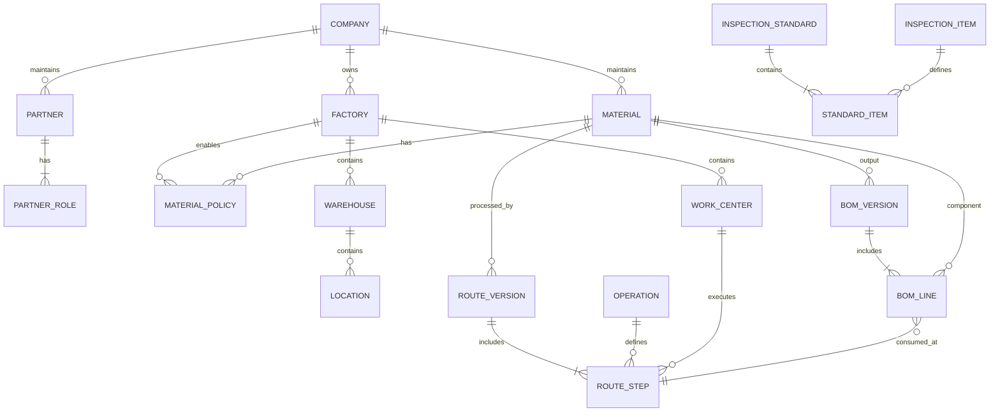

# 主数据模块详细设计

- 版本：V0.1；日期：2026-10-20；性质：业务设计，尚未实施。
- 上游依据：[需求与功能范围基线](需求与功能范围基线.md)。字段与规则为本次设计建议，不将设计文档的形成等同于代码交付或全部细节已获业务确认。
- 用户明确：通用离散制造，兼顾机加工与装配、订单与备货、多层半成品、委外、采购生产销售全链路；暂时不对接外部 ERP/财务。本期数据由本系统独立维护，不代表永不对接，也不代表财务功能已纳入。
- 用户同意先形成主数据详细设计。本文件不确定技术栈、不展开业务单据全套数据库、不启动业务开发。

## 1. 范围、优先级及需求映射

| 顺序 | 本次设计范围 | 对应基线 | 完成标志 |
| --- | --- | --- | --- |
| P0-1 | 组织、仓库库位、基本权限和统一规范 | U-005、F-001、F-002、R-008 | 数据归属、位置和访问边界明确 |
| P0-2 | 客户供应商、单位分类、物料与工厂策略 | U-001～U-005、F-002 | 能定义可采购、可生产、可委外的物料 |
| P0-3 | 工序、工作中心、工艺路线、多层 BOM | U-003、U-004、U-008、F-003、F-010、F-014、F-015、R-003、R-004 | 能表达多层装配、内部加工及工序委外 |
| P0-4 | 检验项目及四类检验标准 | U-006～U-008、F-004、F-019、R-005 | 各环节有明确可选标准及判定条件 |
| P0-5 | 样例贯通及主数据验收 | A-001～A-004 | 主数据可供后续业务单据使用 |

P0 表示主数据阶段必需，不表示所有页面必须同时上线。车间可按实际建立，产线、设备、刀具、复杂产能日历、动态字段引擎不作为本阶段必需。标准工时允许录入，不在本阶段实现排程。扫码、复杂抽样算法、税费、结算、收付款、成本核算不在本设计中默认承诺。

## 2. 统一规范

### 2.1 字段与编码

以下为逻辑字段和概念类型，不限定数据库或编程语言。所有资料具有下表通用字段；后续实体表不重复列出。

| 标识 | 中文 | 类型 | 必填 | 默认与校验 |
| --- | --- | --- | --- | --- |
| id | 内部标识 | 不透明唯一标识 | 系统 | 创建后不可修改，关联使用 id 而非名称 |
| code | 业务编码 | 文本，1～64 字符 | 是 | 去首尾空格；字母统一大写；允许字母数字及 - _ .；唯一范围见下文；停用编码不复用 |
| name | 名称 | 文本，1～200 字符 | 是 | 不得全空白；名称可重名，选择器同时显示编码 |
| status | 生命周期状态 | 枚举 | 是 | 初始 DRAFT；见状态规则 |
| remark | 备注 | 文本，最多 2000 字符 | 否 | 普通文本，不作为业务控制条件 |
| created_at / created_by | 创建时间/人员 | 时间/引用 | 系统 | 不允许客户端改写 |
| updated_at / updated_by | 修改时间/人员 | 时间/引用 | 系统 | 每次保存记录 |
| revision | 并发修订号 | 正整数 | 系统 | 从 1 起，保存校验旧修订号，冲突须重新读取 |

编码可人工维护；自动编号仅作为可替代录入方式，不把日期、名称、版本嵌入内部 id。默认不建设通用可编程编号引擎。

| 资料 | 编码唯一范围 | 归属规则 |
| --- | --- | --- |
| 公司、单位 | 系统内各自唯一 | 公司独立，单位为全局公共字典 |
| 工厂、往来单位、物料、分类、工序、检验项目 | 公司内各自唯一 | company_id 必填；公司间数据不自动共享 |
| 车间、工作中心、仓库、BOM/路线/标准资料编号 | 工厂内各自唯一 | factory_id 必填，并由工厂确定公司 |
| 库位 | 仓库内唯一 | warehouse_id 必填 |
| BOM/路线/检验标准版本号 | 同一资料编号内唯一 | 版本不可复用 |

明细行不强制有通用 code/name/status，使用内部 id、行号及父资料状态。版本头使用资料编号及 version_no；生效范围独立于编码唯一性。

### 2.2 状态、引用及历史

- 普通资料：DRAFT（草稿）→ ACTIVE（启用）→ INACTIVE（停用）。启用前执行完整校验。停用可重新启用，但必须重新校验。
- 版本资料：DRAFT（草稿）→ RELEASED（已发布）→ RETIRED（停用）。已发布内容不可直接修改；调整时复制新版本。停用版本不直接恢复，必要时发布新版本。
- 只有启用资料、已发布且在有效期内的版本可用于新的业务选择。草稿可保存不完整内容，发布/启用必须补全所有必填项。
- 已被其他资料或业务引用的记录不物理删除；仅未引用草稿可删除。停用不删除历史关联、不清空历史显示。
- 上级公司、工厂、仓库停用后，相关下级资料不得用于新业务，界面显示上级停用原因；不以批量改写子级状态掩盖原始状态。
- 停用物料或标准不自动取消已下达订单。后续业务须区分“按既有快照继续执行”和“新的新增引用”；安全或质量原因要求立即禁用的情形进入显式冻结/变更流程，不依赖资料停用隐式处理。
- 已有业务引用后，归属公司、基本单位、追踪策略不得直接改写；需专门迁移评估，本期普通编辑入口禁止修改。编码启用后固定；名称、联系信息等非结构信息可修改并审计。
- 资料停用前显示引用和未完业务数量；BOM、路线及标准发布时再次检查关联对象有效，不以页面选择时的检查代替保存校验。

### 2.3 数量、单位与损耗

- 数量及换算因子使用十进制定点概念，建议最大 6 位小数；不用二进制浮点进行库存或用料累计。超限拒绝，不静默截断。
- 单位定义可用小数位（0～6）；“件”示例为 0，“kg”为 3。手工数量不满足精度时拒绝。计划建议在最终发料单位上按单位精度向上取整，显示原值及取整值，不能在每层计算中提前反复取整。
- 物料基本单位统一计量。物料单位换算表达为“1 个辅助单位 = factor 个基本单位”；factor > 0，只存指向基本单位的换算，不配置相互矛盾的换算链。
- 件与 kg 等不同量纲仅允许物料专属、固定换算且有明确业务依据；重量浮动的双计量暂不纳入，不能用假定常数替代。
- BOM 用量公式：计划理论用量 = 父项计划数量 / BOM 产出基数 × 单行用量 × 单位换算因子；计划含损耗量 = 理论用量 × (1 + loss_rate)。loss_rate 定义为“额外备料占理论用量比例”，范围 0～1，0.05 表示额外 5%，不解释为产出不良率。
- 损耗只是计划值，不能自动形成库存报废或实际耗用；实际业务须记录实际领退耗废。多层需求在每层完成库存和供应净算后再向下展开。

### 2.4 权限、审计与组织一致性

建议配置资料查看、维护、启用/发布、停用四类权限，并按公司/工厂限制访问。普通维护者不能因拥有编辑权限而获得跨公司访问权。物料/BOM/工艺由生产技术角色维护，检验标准由质量角色维护，组织和权限由管理员维护；角色名称可调整。

记录新增、修改前后值、启停用、发布、删除草稿的操作人、时间和原因；不可仅记录最后修改者。接口与页面一致执行授权及组织检查。工厂归属必须与物料、往来单位、工序的公司相同；跨公司协作以后使用明确业务关系，不把不同公司库存混用。

## 3. 实体关系

图中 BOM 行的领料工序在发布时必填；未发布草稿可空。库存不属于主数据实体：未来库存至少区分物权公司、存放位置、物料/批次、质量状态、预留/冻结信息；供应商仅是存放保管方时不能被当成物权人。

## 4. 组织及往来单位字段

### 4.1 公司、工厂、车间及工作中心

| 实体.字段 | 中文 | 类型 | 必填 | 默认与校验 |
| --- | --- | --- | --- | --- |
| company.address | 地址 | 文本 | 否 | 空；不强制法律注册资料 |
| factory.company_id | 所属公司 | 引用 | 是 | 当前有权公司；启用时公司须启用 |
| factory.address | 工厂地址 | 文本 | 否 | 空 |
| workshop.factory_id | 所属工厂 | 引用 | 是 | 车间按需建立 |
| work_center.factory_id | 所属工厂 | 引用 | 是 | 与工序任务所属工厂一致 |
| work_center.workshop_id | 所属车间 | 引用 | 否 | 有值时须同工厂 |
| work_center.kind | 类型 | INTERNAL/EXTERNAL | 是 | INTERNAL |
| work_center.supplier_id | 委外供应商 | 往来单位引用 | 条件 | EXTERNAL 必填且具有启用供应商角色；INTERNAL 必须空 |

工作中心表示执行单元，可代表一组机台、装配工位或外部加工单位；此阶段不建立单台设备档案和自动产能模型。外部工作中心仍属于发起委外的我方工厂。

### 4.2 仓库与库位

| 实体.字段 | 中文 | 类型 | 必填 | 默认与校验 |
| --- | --- | --- | --- | --- |
| warehouse.factory_id | 管理工厂 | 引用 | 是 | 决定管理公司，不等于实际地址 |
| warehouse.location_type | 存放地点类型 | INTERNAL/SUPPLIER | 是 | INTERNAL |
| warehouse.custodian_supplier_id | 保管供应商 | 引用 | 条件 | SUPPLIER 必填，同公司启用供应商；INTERNAL 为空 |
| warehouse.address | 存放地址 | 文本 | 否 | 空 |
| location.warehouse_id | 所属仓库 | 引用 | 是 | 不得跨仓库复用库位 id |
| location.usage_hint | 用途提示 | GENERAL/RAW/WIP/FINISHED/QUARANTINE | 是 | GENERAL；只用于提示和筛选 |

每个启用仓库至少有一个启用库位；不细分库位的仓库创建 DEFAULT 库位。待检区是位置，待检是质量状态，两者独立：移到成品区不代表检验合格，合格物料暂存待检区也不能自动被改成不合格。仓库主数据不保存库存余额。供应商仓记录我方材料及在制所在位置，物权公司由库存记录明确，供应商自有料不混记成我方库存。

### 4.3 往来单位及角色

| 实体.字段 | 中文 | 类型 | 必填 | 默认与校验 |
| --- | --- | --- | --- | --- |
| partner.company_id | 维护公司 | 引用 | 是 | 当前有权公司 |
| partner.roles | 业务角色 | CUSTOMER/SUPPLIER 集合 | 是 | 至少一个；可同时具备两个角色 |
| partner.contact_name | 联系人 | 文本 | 否 | 空 |
| partner.phone | 联系电话 | 文本 | 否 | 空；保留 +、分机等，不作为数字存储 |
| partner.address | 联系地址 | 文本 | 否 | 空 |
| partner.supplier_capabilities | 供应能力 | MATERIAL/PROCESSING 集合 | 条件 | 有供应商角色时至少一项；可同时供料及加工 |
| partner_role.status | 角色状态 | ACTIVE/INACTIVE | 是 | 启用单位时明确；分别控制新销售/采购或委外引用 |

客户和供应商可显示为两个业务入口，共用同一往来单位记录；不能因新增角色复制同公司下同一主体。移除已引用角色改为停用。税号、账期、银行、价格政策不作为本阶段必填项。

## 5. 单位、分类、物料及工厂策略

### 5.1 基础字典与物料

| 实体.字段 | 中文 | 类型 | 必填 | 默认与校验 |
| --- | --- | --- | --- | --- |
| unit.dimension | 计量维度 | COUNT/MASS/LENGTH/VOLUME/OTHER | 是 | 无；建立时明确 |
| unit.decimal_places | 数量小数位 | 整数 0～6 | 是 | 0；被使用后不直接变更 |
| category.company_id | 所属公司 | 引用 | 是 | 当前公司 |
| category.parent_id | 上级分类 | 引用 | 否 | 空为根节点；同公司，不得循环 |
| material.company_id | 所属公司 | 引用 | 是 | 当前公司 |
| material.category_id | 物料分类 | 引用 | 是 | 同公司启用分类 |
| material.material_kind | 物料性质 | RAW/SEMI/FINISHED | 是 | 无；与供应方式分离 |
| material.specification | 规格描述 | 文本 | 否 | 空 |
| material.base_unit_id | 基本单位 | 引用 | 是 | 启用单位 |
| material.tracking_mode | 追踪策略 | NONE/BATCH/SERIAL/BATCH_SERIAL | 是 | 建议 BATCH；示例使用批次，不等于用户已指定所有物料批次管理 |
| material.serial_uniqueness | 序列号唯一范围 | MATERIAL | 条件 | SERIAL 或 BATCH_SERIAL 时固定为公司+物料内唯一；跨物料全局唯一可后续评估 |
| material_unit.unit_id | 辅助单位 | 引用 | 是 | 同物料不得重复，也不重复配置基本单位 |
| material_unit.factor | 换算系数 | 正小数 | 是 | 无；1 辅助单位对应基本单位数量 |

SERIAL/BATCH_SERIAL 物料基本单位须为整数件类单位，每个序列号对应一个基本单位。追踪模式 NONE 仅在明确无需批次追溯时选择；发布相关 BOM/路线不自动覆盖物料追踪策略。

### 5.2 物料在工厂的供应与生产策略

物料编码属于公司，同物料不同工厂可有不同供应方式、工艺和补货策略。

| 实体.字段 | 中文 | 类型 | 必填 | 默认与校验 |
| --- | --- | --- | --- | --- |
| material_policy.material_id / factory_id | 物料/工厂 | 引用 | 是 | 组合唯一，必须同公司 |
| material_policy.allowed_supply_modes | 允许供应方式 | BUY/MAKE/SUBCONTRACT 集合 | 是 | 至少一个；不从物料性质自动推断 |
| material_policy.default_supply_mode | 默认供应方式 | 枚举 | 是 | 必须属于允许集合；订单选择可覆盖为允许的其他方式 |
| material_policy.allowed_production_strategies | 允许生产策略 | MTO/MTS 集合 | 条件 | 允许 MAKE 或 SUBCONTRACT 时至少一个，可同时允许订单及备货 |
| material_policy.default_production_strategy | 默认生产策略 | 枚举 | 条件 | 必须属于允许集合；仅 BUY 可空 |
| material_policy.preferred_supplier_id | 建议供方 | 引用 | 否 | 同公司启用供应商，能力与选用方式匹配；非强制唯一供方 |
| material_policy.default_bom_code | 默认 BOM 资料 | 引用 | 否 | 同工厂同产物；按业务日期解析版本，不能简单永久指向最新版本 |
| material_policy.default_route_code | 默认工艺资料 | 引用 | 否 | 同工厂同产物；与选用 BOM 版本兼容 |
| material_inspection_policy.inspection_type | 非工序检验环节 | IQC/FQC/OQC | 是 | 每个物料工厂组合每类一条 |
| material_inspection_policy.requirement | 检验要求 | REQUIRED/EXEMPT | 是 | REQUIRED |
| material_inspection_policy.exemption_reason | 豁免原因 | 文本 | 条件 | EXEMPT 必填，REQUIRED 为空 |

启用物料策略时允许先没有 BOM/路线，便于顺序建档；生产方案发布及业务下达前必须具备适用版本。工序委外是路线执行方式，不要求产出物料的默认供应方式改成整料委外。预测冲减、库存目标、提前期和供应分配由后续计划设计定义，不在本模块擅自提供全套补货参数。

## 6. 工序、工艺路线和多层 BOM

### 6.1 工序及路线字段

| 实体.字段 | 中文 | 类型 | 必填 | 默认与校验 |
| --- | --- | --- | --- | --- |
| operation.company_id | 所属公司 | 引用 | 是 | 当前公司 |
| operation.description | 操作说明 | 文本 | 否 | 空 |
| route.factory_id / material_id | 工厂/产出物料 | 引用 | 是 | 同公司，物料在工厂启用 |
| route.version_no | 版本号 | 文本 1～32 | 是 | 建议 V1；同资料编号唯一 |
| route.effective_from / effective_to | 生效起止 | 时间 | 起必填 | 左闭右开；止可空且必须晚于起 |
| route_step.sequence | 工序顺序 | 正整数 | 是 | 同版本唯一；建议 10、20、30 留出插入空间 |
| route_step.operation_id | 标准工序 | 引用 | 是 | 同公司启用 |
| route_step.execution_mode | 执行方式 | INTERNAL/OUTSOURCE | 是 | INTERNAL |
| route_step.work_center_id | 工作中心 | 引用 | 是 | 同工厂；类型须与执行方式匹配 |
| route_step.standard_minutes | 单件参考工时 | 非负小数 | 否 | 空表示未维护，0 表示明确为零；单位为分钟/基本产出单位 |
| route_step.inspection_required | 工序必检 | 布尔 | 是 | false；为 true 时须有适用已发布标准 |
| route_step.instruction | 作业说明 | 文本 | 否 | 空 |

初版路线按顺序串行执行；并行、替代路线自动选择、返工环路不通过重复顺序或循环路线表达，后续异常业务另行设计。允许不同工序重复使用同一 operation_id，以 route_step.id 区分。

### 6.2 BOM 头及明细字段

| 实体.字段 | 中文 | 类型 | 必填 | 默认与校验 |
| --- | --- | --- | --- | --- |
| bom.factory_id / output_material_id | 工厂/产出物料 | 引用 | 是 | 同公司，物料在工厂启用 |
| bom.version_no | 版本号 | 文本 1～32 | 是 | 同资料编号唯一 |
| bom.output_base_qty | 产出基数 | 正小数 | 是 | 默认 1；单位为产物基本单位 |
| bom.route_version_id | 对应工艺版本 | 引用 | 是 | 同产物同工厂；引用确定版本 |
| bom.effective_from / effective_to | 生效起止 | 时间 | 起必填 | 左闭右开；发布时有可用匹配路线 |
| bom_line.line_no | 行号 | 正整数 | 是 | 同版本唯一 |
| bom_line.component_material_id | 子项物料 | 引用 | 是 | 同公司，工厂策略启用；不得等于父项 |
| bom_line.quantity / unit_id | 子项用量/单位 | 正小数/引用 | 是 | 单位须为子项基本单位或已定义辅助单位 |
| bom_line.loss_rate | 额外备料比例 | 小数 0～1 | 是 | 0；公式见 2.3 |
| bom_line.consume_step_id | 领料工序 | 引用 | 是 | 必须属于头部指定路线版本 |
| bom_line.structure_mode | 子项展开方式 | STOCKED/PHANTOM | 是 | STOCKED；虚拟件按下文约束 |
| bom_line.supply_responsibility | 整料委外供料责任 | OURS/SUPPLIER | 是 | OURS；仅在整料委外执行时启用解释 |

普通自制执行时，所有实际领用子项均按我方库存管理；SUPPLIER 字段不能使自制订单跳过用料。整料委外中 OURS 形成我方发料及核销，SUPPLIER 由供应商供料，不生成我方该原料库存；一张 BOM 不同行可分别指定，表达混合供料。同一子项在同一工序同一责任下不得重复行，确需不同工序使用可分行。

STOCKED 半成品独立计划、生产或委外、检验及入库，上层通过领料消耗；PHANTOM 仅用于展开分组，不独立生产和入库。虚拟件需要有效子 BOM，且不具有独立加工需求；初版仅允许将其展开子项统一领用于上层指定工序，需要独立工序的半成品必须用 STOCKED。

### 6.3 循环、版本、生效与发布

1. 保存时检查直接自引用，发布时遍历适用的多层 BOM，检查间接循环并返回完整路径，例如 A→B→C→A。虚拟件也参与检查。
2. 初版不支持同物料同工厂同一时刻自动选择多个默认生产方案；若存在多个候选，必须显式选择，不以“最后修改”作为规则。
3. 同一资料编号的已发布版本有效期不得重叠。时间统一存储、界面按工厂业务时区展示；初版工厂业务时区建议 Asia/Hong_Kong，可在技术设计时落实。
4. 发布路线先检查工序、工作中心及必检标准；发布 BOM 再检查路线版本、领料工序、子项有效性、循环和单位换算。版本有效期需与依赖版本有覆盖关系；涉及未来生效的子 BOM，发布其新版本时也须检查受影响上层，业务下达时再次解析全层版本并检查循环。
5. 发布新版本须记录原因。旧版本需要截断有效期时，由受权限控制的“版本替代”操作记录旧值、新值和原因；不开放任意编辑已发布内容。
6. 发布和选用不存在“永远指向最新版”。未来生产/委外订单必须按计划采用日期解析、存储各层实际选中版本，并保存用量、换算、工序、损耗、检验判定等关键快照。已下达订单变更需要显式变更记录，不因资料更新被动变化。

以上订单快照是后续接口及验收约束，当前尚无实现。BOM 展开预览给出毛需求，不等于已实现物料净需求计算或库存分配。

## 7. 检验项目和四类检验标准

### 7.1 字段

| 实体.字段 | 中文 | 类型 | 必填 | 默认与校验 |
| --- | --- | --- | --- | --- |
| inspection_item.company_id | 所属公司 | 引用 | 是 | 当前公司 |
| inspection_item.result_type | 结果类型 | NUMBER/BOOLEAN | 是 | 无；初版避免用自由文本自动判定合格 |
| inspection_item.measure_unit | 测量单位 | 文本 | 条件 | NUMBER 必填，如 mm；BOOLEAN 为空 |
| inspection_item.method | 检验方法 | 文本 | 是 | 如卡尺测量、外观检查 |
| standard.factory_id / material_id | 工厂/物料 | 引用 | 是 | 同公司，适用工厂物料 |
| standard.inspection_type | 检验环节 | IQC/IPQC/FQC/OQC | 是 | 分别为进货、工序、完工、出库检 |
| standard.operation_id | 适用工序 | 引用 | 条件 | IPQC 必填，其余为空 |
| standard.customer_id | 适用客户 | 引用 | 否 | 初版仅 OQC 允许；启用客户角色 |
| standard.version_no | 版本号 | 文本 1～32 | 是 | 同资料编号唯一 |
| standard.effective_from / effective_to | 生效起止 | 时间 | 起必填 | 与版本统一规则一致 |
| standard.required | 必检 | 布尔 | 是 | true；明确豁免才改 false，记录原因 |
| standard.sampling_mode | 检验方式 | FULL/FIXED_SAMPLE | 是 | FULL |
| standard.sample_size | 固定抽样数 | 正整数 | 条件 | FIXED_SAMPLE 必填；实际样本数=min(批量件数,配置数) |
| standard.acceptance_number | 允许不合格样本数 | 非负整数 | 是 | 初版固定 0；复杂 AQL 后续确定 |
| standard_item.item_id | 检验项目 | 引用 | 是 | 同公司启用项目，同标准不重复 |
| standard_item.lower / upper | 下限/上限 | 十进制数 | 条件 | NUMBER 至少一项，若都有则下限≤上限；边界包含 |
| standard_item.expected_boolean | 期望结果 | 布尔 | 条件 | BOOLEAN 必填，默认 true |

抽样 FULL/FIXED_SAMPLE 初版用于件类批量；散装质量或长度物料的采样单位、样本定义另行确认，不把 kg 直接当作样本件数。每个样本的全部项目均满足才为合格，出现不合格样本则检验批判不合格；让步接收属于授权处置，不能回改原始测量结果。未填完必需结果为“未完成”，不得自动合格。

### 7.2 标准选择与门禁配置

- 匹配工厂、物料、环节、业务采用日期；IPQC 额外匹配工序。OQC 先选对应客户专用标准，无专用再选通用标准。
- 同一精确适用范围同一时间只允许一套有效标准，发布时检测歧义；客户专用标准必须是完整标准，不隐式与通用标准拼接。
- 路线工序必检为 true 时，匹配到的 IPQC 标准也必须 required=true。未找到标准或存在多个候选时阻断相关方案发布/后续业务下达，不能默认免检。
- 对非工序环节，物料工厂检验策略另设 IQC/FQC/OQC 的 REQUIRED/EXEMPT 配置，每项必填，默认 REQUIRED；EXEMPT 须记录原因。REQUIRED 须在首次业务执行前存在适用已发布标准；物料初次建档不因标准尚未建立而形成建档循环。
- 四检的业务门禁分别控制进货放行、受控工序流转、完工放行及发货放行，实施时与质量状态关联；本模块只维护规则，不生成检验结果或库存状态。

## 8. 页面、基础操作与跨实体校验

| 页面类型 | 列表操作 | 表单操作 | 额外校验/展示 |
| --- | --- | --- | --- |
| 普通主数据 | 编码/名称搜索、状态及组织筛选、分页 | 新建草稿、编辑、启用、停用、查看引用和审计 | 默认显示当前有权组织，不向无权用户泄露搜索结果 |
| 物料 | 增加性质、供应方式筛选 | 基本资料、单位换算、工厂策略、检验策略分页签 | 显示允许值与默认值；提交时校验集合包含关系 |
| BOM | 产物/工厂/状态/日期筛选 | 草稿编辑、复制新版本、展开预览、发布、停用 | 预览显示各层路径、版本、毛需求、损耗与取整，不宣称是净需求 |
| 工艺路线 | 产物、工序、工作中心筛选 | 工序行增删排序、复制、发布 | 引用顺序稳定 id，不用行序号作为永久外键 |
| 检验标准 | 环节、物料、工序、客户筛选 | 项目编辑、判定预览、复制、发布 | 对示例测量值显示合格/不合格/未完成及原因 |

全部操作需服务端重复校验，不只依赖前端必填。保存草稿可提示问题而不发布；启用/发布返回可定位到字段或明细行的错误。复制生成新 id 和新编码/版本，状态重置草稿，不复制审计历史。批量导入、附件和复杂审批流可以后续增加，不阻碍第一条链路；首批样例可通过表单建立。资料修改不会直接增加、减少或转移任何库存。

## 9. 一致性样例

以下均为虚构测试数据，不代表企业实际规模。生效日期统一为 2026-10-20，所有用料损耗为 0，数量以件计，未给出的库存为 0。

### 9.1 组织、位置与基础资料

| 类别 | 编码及名称 | 配置 |
| --- | --- | --- |
| 公司/工厂 | C01 示例制造公司 / F01 示例工厂 | F01 属 C01 |
| 客户 | CU01 示例客户 | CUSTOMER |
| 供方 | SU01 原料供方 / SU02 表面处理供方 / SU03 整料委外供方 | 分别 MATERIAL、PROCESSING、MATERIAL+PROCESSING |
| 仓库/库位 | WH01 厂内仓：RAW、WIP、FG、QA | INTERNAL；QA 为隔离用途提示，不替代质量状态 |
| 供应商处仓 | WH02：SU02/DEFAULT；WH03：SU03/DEFAULT | SUPPLIER；记录我方发出的在制或物料 |
| 单位 | PCS 件、BOX 箱 | COUNT，数量小数位 0 |
| 工作中心 | WC10 机加工、WC20 外协表面处理、WC30 组件装配、WC40 总装、WC50 整料委外 | WC20 关联 SU02、WC50 关联 SU03，其余内部 |

| 物料 | 性质 | 允许供应/默认 | 生产策略 | 追踪 |
| --- | --- | --- | --- | --- |
| R01 金属毛坯 | RAW | BUY / BUY | 不适用 | BATCH |
| R02 紧固件 | RAW | BUY / BUY | 不适用 | BATCH |
| H01 机加工半成品 | SEMI | MAKE、SUBCONTRACT / MAKE | MTO、MTS / MTS | BATCH |
| H02 装配组件 | SEMI | MAKE / MAKE | MTO、MTS / MTS | BATCH |
| P01 成品总成 | FINISHED | MAKE / MAKE | MTO、MTS / MTO | BATCH |

所有物料基本单位 PCS；仅 R02 增加 BOX 换算，1 BOX=100 PCS。同公司其他物料不能自动继承此箱规。

### 9.2 BOM 与路线

| BOM V1 | 产出基数 | 子项用量 | 领料工序 | 路线 V1 |
| --- | --- | --- | --- | --- |
| B-H01 | H01 1 PCS | R01 1 PCS | RT-H01/10 | 10 机加工 WC10 → 20 表面处理 WC20（委外、必检） |
| B-H02 | H02 1 PCS | H01 2 PCS；R02 2 PCS | RT-H02/10 | 10 组件装配 WC30（必检） |
| B-P01 | P01 1 PCS | H02 1 PCS；R02 2 PCS | RT-P01/10 | 10 总装 WC40（必检） |

三个 BOM 子项结构均为 STOCKED；整料委外供料责任默认为 OURS。H01 的表面处理接收的是同一 H01 生产订单的工序在制品，不额外生成一个 H01 成品供应，也不在工序发出时再领一次 R01。

P01 需求 10 PCS、初始可用库存为 0、无其他供应时：H02 需求 10 PCS；H01 需求 20 PCS；R01 需求 20 PCS；R02 为组件 20 PCS + 总装 20 PCS = 40 PCS（0.4 BOX 仅是换算展示，BOX 精度为 0，实际采购若按整箱则为 1 BOX，余量仍为库存）。为避免采购包装规则干扰主数据验收，本样例按 PCS 采购 R02。

若已有合格可用 H01 6 PCS，后续计划净算应只补 H01 14 PCS及其 R01 14 PCS，不仍按 20 生产；H02 和 P01 数量不变。此为后续计划接口验收，不声称主数据模块会扣减库存。

整料委外替代场景：H01 本次供应改选 SUBCONTRACT，以独立的 20 PCS 委外需求使用 B-H01 的材料定额，给 SU03 发 R01 20 PCS并收回 H01 20 PCS；委外订单采用整料委外执行，不再同时下达内部 RT-H01 工序任务。这是替代前述 H01 自制供应的另一测试用例，不能将两者相加得到 40 PCS。WC50 是供方执行单元，整料委外不强制执行内部路线；BOM 的内部领料工序映射只对内部自制生效。

### 9.3 四检标准映射

| 标准 V1 | 环节/对象 | 方法与判定 | 抽样 |
| --- | --- | --- | --- |
| IQ-R01 | IQC / R01 | 外观完好=true | FULL |
| IQ-R02 | IQC / R02 | 规格一致=true | FULL |
| IP-H01 | IPQC / H01 / 表面处理 | 表面合格=true | FULL |
| IP-H02 | IPQC / H02 / 组件装配 | 装配到位=true | FULL |
| IP-P01 | IPQC / P01 / 总装 | 功能正常=true | FULL |
| FQ-H01 | FQC / H01 | 外径 9.98～10.02 mm（含边界） | FULL |
| FQ-H02 | FQC / H02 | 组件完整=true | FULL |
| FQ-P01 | FQC / P01 | 功能正常=true | FULL |
| OQ-P01 | OQC / P01 / 通用客户 | 包装完好=true、标签正确=true | FULL |
| IQ-H01 | IQC / H01 | 外径 9.98～10.02 mm（含边界） | FULL |

IQ-H01 用于整料委外收回；工序委外收回使用 IP-H01，不重复当作采购成品入库。后续质量单据可区分“委外收回”来源，但沿用明确的检验标准类别。R01/R02 仅启用 IQC，H01 启用 IQC/FQC，H02 启用 FQC，P01 启用 FQC/OQC；其余非工序环节配置 EXEMPT，原因分别为“无此采购/制造/销售场景”。IPQC 由上述路线必检配置启用。若以后出售 H01 或采购 P01，必须先补齐相应策略与标准，不能继承样例豁免直接上线。

## 10. 主数据可测验收清单

以下为未来实施的验收定义，目前未执行业务测试，不等同于已通过。

| 编号 | 操作与前提 | 预期结果 | 基线 |
| --- | --- | --- | --- |
| MD-01 | 同公司新增重复物料编码，不同公司新增相同编码 | 前者拒绝，后者在有权限时允许；历史停用编码仍不得复用 | F-002、R-008 |
| MD-02 | 停用已引用物料后删除；查询旧引用；创建新引用 | 删除拒绝，旧记录可查，新选择拒绝；已下达订单按快照策略处理 | R-004、R-009 |
| MD-03 | 用 C01 物料关联另一公司工作中心/供应商 | 保存或发布拒绝，定位到字段 | R-008 |
| MD-04 | R02 输入 2 BOX；输入 0.5 PCS；为其他物料使用 R02 换算 | 分别得到 200 PCS、拒绝小数件、拒绝未定义换算 | F-002 |
| MD-05 | H01 允许 MAKE/SUBCONTRACT，默认 BUY | 拒绝；改为 MAKE 后通过；MTO/MTS 可同时配置 | U-002、U-004 |
| MD-06 | 展开 P01 10 PCS，零损耗 | H02=10、H01=20、R01=20、R02=40；路径与版本明确 | U-003、F-010 |
| MD-07 | 临时草稿给 H01 子项加入 P01，尝试发布 | 拒绝循环 P01→H02→H01→P01，并显示路径 | F-003、F-010 |
| MD-08 | 临时 BOM 将 R01 损耗设 0.05，H01 数量 20 | 理论 20 PCS、计划 21 PCS，不自动生成报废记录 | F-003、R-003 |
| MD-09 | 将 BOM 子项领料工序指向其他路线；外协工序选内部工作中心 | 均拒绝发布 | F-003、F-014 |
| MD-10 | 发布 V2 与 V1 同资料有效期重叠；编辑已发布用量 | 前者拒绝或走有审计的版本替代，后者禁止；新草稿可编辑 | R-004 |
| MD-11 | FQ-H01 输入 9.98、10.02、10.03、空值 | 依次合格、合格、不合格、未完成 | F-004、F-019 |
| MD-12 | 为同范围发布重叠标准；必检工序无适用标准 | 均阻断发布；不默认免检 | R-005 |
| MD-13 | 建立 WH02 并查看 SU02 角色、库位用途和质量策略 | 外部地点供应商必填；地点与质量独立，建档不会产生任何库存 | R-003、R-007 |
| MD-14 | 复制 H01 供应样例分别选自制含工序委外和整料委外 | 均可表达，明确为替代方案；不把工序收回当第二份 H01 供应 | F-014～F-016、R-002 |
| MD-15 | 无发布权限人员发布；两个会话用同修订号保存 | 前者拒绝，后者只允许先成功者写入，另一方提示冲突 | F-001 |
| MD-16 | 维护草稿、发布、停用、复制版本 | 各操作有审计；复制为新草稿；历史版本仍可查看 | R-004、R-009 |

进入后续单据开发后追加 A-001～A-004 业务验收，验证实物数量、质量门禁、订单快照和委外库存。主数据验收通过不能代替全链路验收。

## 11. 未决项与开发顺序

### 11.1 已确认与待落地

- 已确认外部系统边界：暂不对接，关联 Q-004；后续对接另立需求。
- 企业实际组织规模、逐件管理对象、扫码范围、财务边界仍对应 Q-001、Q-002、Q-003、Q-005，不因样例被确认。
- 本文提出的编码范围、权限角色、版本管理、损耗公式、简单抽样属于明确设计建议。可据此进行技术设计；实际样例与企业规则有差异时记录变更，不静默更改基线。
- 首批实施前需要落实部署和使用边界、技术架构、身份认证及持久化方案；不必为此重新确认已经明确的机加工、装配、多层半成品和委外需求。

### 11.2 后续交付顺序

1. 将本文转换为技术设计与任务清单：逻辑实体到存储约束、接口、页面、鉴权、事务与并发策略；引用 MD 验收编号，暂不扩张全部业务单据。
2. 实施统一基础能力及公司/工厂/仓库库位、往来单位、单位/分类/物料；使用最少必需界面完成样例建档。
3. 实施工序/工作中心及检验项目标准，再实现路线和 BOM 发布校验，避免必检路线找不到标准的建档依赖问题。
4. 完成版本、引用、权限和样例验收，形成验收证据及缺口清单。
5. 进入 A-001 首条订单闭环，再在同一期完成 A-002 多层装配、A-003 工序委外、A-004 整料委外及异常场景。多层及两类委外在模型阶段已经预留，不推迟到二期。

此顺序为计划建议，当前交付止于本设计文档；尚未开始编码、迁移数据库、提交或部署。
