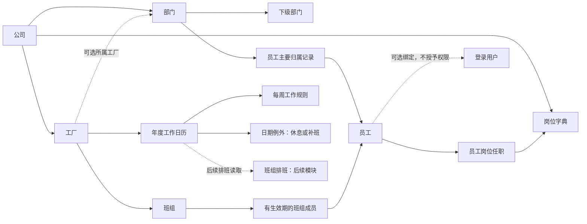

# 组织管理落地方案

- 日期：2026-10-23；版本：V0.2，完整组织目标待分批实施。
- 本次用户已授权首批公司、工厂、工厂日历三个模块；以[组织管理首批实施契约](组织管理首批实施契约.md)为本批执行边界。本文件中人员、部门、岗位、班组及七菜单全部完成的要求属于后续完整目标，不要求本批建表或制作占位页。
- 本次交付是业务与技术方案，不代表页面、数据库或生产环境已经变更。
- 承接《需求与功能范围基线》《主数据模块详细设计》《技术设计与实施计划》；数据库实施以当前 MySQL 8.4 代码及《MySQL切换方案》为准，不能沿用旧文档中的 PostgreSQL 迁移方法。

## 1. 需求边界与默认决策

**用户已明确**：增加一级“组织管理”，包含公司管理、工厂管理、部门管理、员工管理、班组管理、岗位管理、工作日历管理七个二级菜单；公司下有工厂和部门，部门有员工，员工关联岗位，工厂有班组，班组包含员工；工厂可编辑休息日，供班组后续排班使用。原话“排版”在此按“排班”理解。

**本方案推荐**：把行政归属、生产协作、工作日期规则分别建模。部门不强制挂在工厂下；员工属于一个主要部门，可兼任岗位；班组作为工厂的人员协作单元，不作为部门子节点。日历定义哪天工作或休息，班次定义几点到几点，排班定义谁在哪天上什么班。本期交付前者与人员关系，不扩展工资、考勤、假勤、自动排产、设备产能或完整人力资源系统。

| 未明确细节 | 推荐默认值 | 后续需要改变时 |
| --- | --- | --- |
| 部门归属 | 必须属于公司，可选工厂；支持部门层级 | 不增加集团多级法人树 |
| 员工岗位 | 一个主要部门；允许多个岗位，最多一个主岗位 | 不把岗位等同系统角色或资质认证 |
| 班组成员 | 员工同一天最多属于一个班组；允许不同部门成员组成同厂班组 | 跨班组兼职、跨厂借调另开规则，不放开简单多选 |
| 跨公司 | 禁止直接关联；调入另一公司建立该公司的员工档案 | 人员跨法人统一身份以后单独设计 |
| 工作周 | 新建草稿预填周一至周五工作、周末休息，由用户保存启用确认 | 可改六天或七天工作，不能静默给现有工厂套用 |
| 日期粒度 | 按自然日，不做半天休息和小时级产能 | 班次/跨夜班以后独立处理 |
| 人员信息权限 | 本期员工及任职明细默认仅管理员维护和查看 | 若需非管理员管理人员，实施前增加明确人员权限，不直接沿用物料编辑权限 |

这些是建议默认值，不将其写成用户已确认。最影响范围的是多班组兼职、跨厂借调、非管理员人员权限；按上述默认即可形成首版。

## 2. 现有工程与增量

本次只读检查本地源码与设计文档，未连接生产数据库，也未宣称运行验收通过。

| 现状 | 证据 | 本次处理 |
| --- | --- | --- |
| 公司、工厂已有数据模型与通用 CRUD/状态逻辑 | `db/mysql/001_initial.json`；`apps/api/src/master.ts` 的 `entities`、`scope`、`effective` | 复用原表、ID、编码及接口，不复制一套组织公司/工厂 |
| 组织与仓储混在一个导航组 | `apps/web/src/main.tsx` 的 `menu` | 公司/工厂移入组织管理；仓库/库位保留在“仓储基础” |
| 固定角色及公司、工厂授权 | `users`、`user_company_scopes`、`user_factory_scopes` | 不因部门、主管或班组成员身份扩大权限 |
| 尚未见部门、员工、岗位、班组、日历业务实现 | 当前 API 实体白名单、Web 菜单、MySQL 初始表清单 | 新增五类业务页面及其关联表 |
| 当前运行数据库接入 MySQL | `apps/api/src/db.ts` 使用 mysql2；`scripts/migrate.ts` 默认读取 `db/mysql` | 新增顺序 JSON 迁移，保留原迁移 checksum |

原通用 `effective` 对 `parent_id` 按物料分类解释；新部门不能直接套用该逻辑，否则会查错实体。新增组织服务显式处理部门祖先、人员生效区间与日历；保留现有物料行为。前端当前集中在 `main.tsx`，建议新页放独立组织页面/组件，局部提取列表能力，不要求全面重写旧页面。

## 3. 模型与组织展示

界面可提供“行政视图：公司→部门→员工”和“生产视图：公司→工厂→班组→员工”。这是两个查询投影；不把员工复制建档，也不把岗位、日历强行塞进一棵可拖动组织树。公司与工厂管理中的关联计数、详情跳转遵循数据权限。

### 3.1 公司、工厂、部门

- 工厂只属于一个公司；有引用后不允许直接变更所属公司。公司直属部门允许 `factory_id` 为空，如财务、人事；工厂部门必须与工厂同公司。
- 部门父级必须同公司，禁止自身/间接循环。公司级部门的子级可以是公司级或工厂级；工厂级部门的所有下级必须同一工厂，禁止跨厂挂接或回到公司级。公司级部门下可以分别挂 F01、F02 的部门，满足总部职能统筹。
- 部门编码公司内唯一；不按名称合并部门。启用后公司、工厂归属固定。重组改变工厂边界时新建部门并迁移员工有效期；同范围内调整父级须记录原因与前后路径，不能连带修改人员权限。
- 部门负责人为可选关联，须同公司、在任日期内在职，工厂部门负责人还须在同厂。允许由上级部门员工兼任，不强制本人位于所负责部门；负责人不是授权角色。

### 3.2 员工与任职

- 员工为业务人员档案，登录用户为认证身份。员工不必拥有账号，系统管理员不必建立员工档案；可选一对一绑定，只有管理员操作，禁止同一账号绑定两个员工。离职流程单独提示停用账号并撤销会话，不能仅改员工状态后声称账号已禁用。
- 员工公司固定；工号公司内唯一且离职后不复用。姓名可重名；不采集身份证、银行账户、薪资等本次无关信息。
- 用有效期记录主要部门与主要工作工厂。启用且在职员工在任职区间内必须有且仅有一个主要部门；公司直属人员可以没有工作工厂，工厂部门员工的工作工厂必须等于部门工厂。公司级部门员工可指定一个同公司工作工厂，例如驻厂质量工程师。
- 岗位是公司级职责字典，如操作工、检验员、班组长，不是具体人员编制席位。员工可有多个岗位，最多一个主岗位；首版要求可排班员工至少一个有效岗位。岗位本身不等于技能认证，不据此自动宣称可操作某台设备。
- 主要部门/工作工厂调动与岗位变更通过带生效日期的操作完成，不直接覆盖历史。员工状态展示按入职日、离职生效日计算“待入职/在职/已离职”；资料草稿/启用/停用单独保留，防止停用被误当离职。
- 部门负责人、班组长离职或调出适用范围时，变更预览列出待替换/待结束任命；同事务结束相关任命，不留一个显示为有效的离职负责人。

### 3.3 班组与成员

- 班组属于固定工厂，编码在工厂内唯一，可选管理部门；有部门时该部门须同公司且为公司级或同工厂部门。班组与工作中心/产线不是同一对象，本次不强制绑定未实现的生产资源。
- 成员必须同公司、在对应日期在职，主要工作工厂等于班组工厂；部门可以不同。公司直属且未配置工作工厂的员工不能直接加班组，须先明确工作工厂。
- 同一天最多一个班组成员关系；调班组以结束旧关系、建立新关系完成。首版不支持靠重复成员记录表达跨厂支援。调工厂时在同一事务结束旧厂班组关系，再允许加入新厂班组。
- 一个班组同一天最多一个班组长；班组长必须是该日有效成员，成员结束时同步结束班组长任期。班组可先启用为空组，状态显示“未配置成员/班组长”；未来发布排班时再要求目标日期有成员和负责人，不制造初始化循环。

## 4. 时间、状态、并发与历史规则

关联区间统一为 `[valid_from, valid_to)`，结束日不包含；空结束日表示长期。界面明确显示“生效日”和“失效日（当天起不再有效）”，避免把最后工作日与离职生效日混淆。DATE 使用组织业务日期，审计时间使用 UTC DATETIME(6)。首版默认 Asia/Shanghai，工厂允许有效 IANA 时区；已有日期资料后修改时区需专门变更，不静默平移日期。

时间记录只允许有效区间，`valid_to > valid_from`；支持未来生效，默认禁止回溯修改已生效历史，历史录错由受控纠错操作记录原因、原值和影响。未来记录允许调整/撤销并审计；已过去的成员、部门和岗位关系不能物理删除。

MySQL 不提供本方案所需的区间排他约束，不能只用 UNIQUE 假装解决重叠。每次更新在事务内锁定员工行；同班组长的变更同时锁班组行；部门调整锁同公司组织结构键。所有写入口采用同一锁顺序，随后检查交集 `old.from < new.to AND new.from < old.to`（空结束按无穷），最后写入、增加 revision、写审计。同范围并发两个新增必须最多成功一个。部门负责人任期也按部门锁防重叠。

基础资料沿用 DRAFT→ACTIVE→INACTIVE、仅未引用草稿可删除、停用编码不复用。新引用须目标及上级有效，历史资料保留名称与关联。停用上级不批量改写下级状态，计算有效性并列出原因。涉及人员未来任职、负责人、班组成员的停用必须先展示影响并处理冲突；不能留下原本计划生效但实际无效的关系。

未来接入排班后，人员调动、离职、班组成员变更和日历变化须返回受影响的未来草稿/已发布排班。草稿可显式重算；已发布排班须变更/重新发布，禁止后台自动覆盖；过去已执行排班保存当时成员和日历版本快照。**本期界面须显示“排班模块尚未接入，未核查排班影响”**，不能显示未经查询的“影响 0 条”。

## 5. 工厂工作日历

### 5.1 数据语义

每个工厂每年一个日历档案，包含工作周规则与日期例外；全年日期从规则计算，不必预生成 365/366 条普通日期。规则优先级：**日期例外 > 该日适用的工作周规则**。

- 工作周采用周一至周日七个工作/休息标志；若年中改变单双休，从指定日期新增规则区间，不能改写整年历史。启用时规则须无重叠并完整覆盖年度。
- 日期例外仅 WORK（补班/指定工作日）或 REST（指定休息日），同日唯一；“恢复默认”删除该日例外并重新继承工作周，不等于强制工作。
- 日期不在当前年度、例外类型不合法或工作周覆盖缺失，保存/启用拒绝。未建或未启用年度日历返回“未配置”，不能当作全工作或全休息。
- 法定节假日不自动猜测，不内置未经维护的假日表；支持管理员手工批量设定放假及周末补班。节日名称为说明，不改变实际工作/休息语义。
- 班组默认使用其工厂日历；本期不允许班组覆盖工厂休息日。将来连续生产/特殊加班通过排班模块显式授权例外，不能偷偷改全厂日历。

### 5.2 页面操作

顶部：公司、工厂、年份选择，日历状态、revision、时区、配置提示；主体月历，支持上一月/下一月/回到本月和年度概览。日期格显示“工作/休息/补班”、来源“周规则/日期例外”及备注；有文字和图标，不只靠红绿颜色。

点击一天或勾选多个日期，执行“设为休息”“设为工作”“恢复周规则”；支持按日期范围筛选每周几，如批量周六补班。侧栏编辑备注与原因；先预览变化日期、工作/休息总天数，再保存。批量保存全部成功或全部失败，失败指出具体日期；revision 过期返回冲突并保留待编辑内容，不能覆盖别人调整。

“复制上一年”默认只复制周规则，例外日期不直接平移（节日可能不在同一天）；选择复制例外时须逐条预览并处理 2 月 29 日，首版可以只提供周规则复制。过去日期只读；管理员纠错另入口，原因必填。启用/更新检查覆盖年度，并记录前后差异；工厂缺日历、下年度未配置作为提示，不阻止与排班无关的物料维护。

例：工厂默认双休；把周日设 WORK 得到补班，把周三设 REST 得到休息，随后恢复周日默认则回到休息。班组日历预览应得到相同结果，但不因此产生任何早班/晚班记录。

## 6. 七个菜单的具体交付

| 二级菜单 | 列表与筛选 | 详情/维护及完成标准 |
| --- | --- | --- |
| 公司管理 | 编码、名称、状态 | 复用现有增改启停、引用审计；展示有权工厂/部门入口 |
| 工厂管理 | 公司、编码、名称、状态 | 复用资料；增加时区、班组和日历入口及配置状态 |
| 部门管理 | 公司、可选工厂、树/列表、状态 | 建立父子部门、调整同范围父级、负责人任期、人员列表；防环和归属校验 |
| 员工管理 | 公司、主要部门、工作工厂、岗位、班组、在职状态、工号/姓名 | 基本档案、归属变更、岗位任职、班组历史、离职、可选登录账号；当前和指定日期查询 |
| 班组管理 | 公司、工厂、编码、状态 | 管理部门、成员增减、生效日期、班组长、日历预览；不展示未实现排班按钮 |
| 岗位管理 | 公司、编码、名称、状态 | 职责说明、启停、任职员工及引用；停用后不可新增任职 |
| 工作日历管理 | 公司、工厂、年份、配置状态 | 可操作月历、周规则、休息/补班例外、批量预览保存、年度复制周规则、审计 |

导航使用真正的一级折叠菜单“组织管理”，七个中文二级菜单顺序按用户要求。仓库/库位迁到“仓储基础”，原资源标识和数据不变；系统用户权限仍独立。每页均需加载、空状态、失败重试、分页/必要筛选和中文校验。员工从部门或班组页进入时仍是同一档案；重复入口不能重复保存人员数据。

## 7. 建议表结构与约束

复用 UUID CHAR(36)、编码 64、名称 200、备注 2000、通用状态、revision、created/updated 及操作人；沿用现有字符集/排序规则和编码标准化。新增表仅列关键字段，实施时须完整映射审计和外键。

| 表 | 关键字段 | 唯一键与约束 |
| --- | --- | --- |
| `factories` 增量 | `timezone` | 新字段默认 Asia/Shanghai；原 ID/company/code 不变 |
| `departments` | company_id、factory_id 可空、parent_id 可空、通用字段 | UNIQUE(company_id,code)、UNIQUE(id,company_id)；父级与工厂同公司复合 FK；层级规则由服务检查 |
| `employees` | company_id、code 工号、name、join_date、leave_effective_date 可空、phone 可空、user_id 可空 | UNIQUE(company_id,code)、UNIQUE(id,company_id)、UNIQUE(user_id)；离职生效日须晚于入职日 |
| `employee_assignments` | employee_id、company_id、department_id、factory_id 可空、valid_from/to、reason | 员工/部门/工厂同公司 FK；员工区间不重叠，在职启用区间无缺口 |
| `positions` | company_id、code、name、duties、通用字段 | UNIQUE(company_id,code)、UNIQUE(id,company_id) |
| `employee_positions` | employee_id、position_id、company_id、is_primary、valid_from/to、reason | 同公司复合 FK；同人同岗位区间不重叠，主岗位区间最多一个 |
| `teams` | company_id、factory_id、department_id 可空、通用字段 | UNIQUE(factory_id,code)、UNIQUE(id,company_id,factory_id)；同公司与工厂约束 |
| `team_members` | team_id、employee_id、company_id、factory_id、valid_from/to、reason | 班组复合 FK，员工同公司 FK；跨班组按员工区间防重叠；按日期检查工作工厂 |
| `team_leaders` | team_id、employee_id、company_id、factory_id、valid_from/to | 同厂同公司；任期完全被该组成员区间覆盖；每组最多一个有效班组长 |
| `department_managers` | department_id、employee_id、company_id、valid_from/to | 同公司；每部门最多一个有效负责人，人员在职及工作工厂校验 |
| `factory_calendars` | company_id、factory_id、year、status、revision、通用审计字段 | UNIQUE(factory_id,year)；按工厂授权；无需另建可随意重名的日历编码 |
| `calendar_week_patterns` | calendar_id、valid_from/to、七个 weekday_work 标志 | 区间限年度、无重叠、启用时全年度覆盖；标志仅 0/1 |
| `calendar_exceptions` | calendar_id、date、day_type、note | UNIQUE(calendar_id,date)，日期限年度；WORK/REST CHECK |

必要索引：部门(company_id,parent_id)、员工(company_id,code)、各任职表(employee_id,valid_from,valid_to)、成员(team_id,valid_from,valid_to)、负责人(department_id,valid_from,valid_to)、日历(factory_id,year)。姓名搜索按现有分页方案，不引入外部搜索引擎。

所有外键 RESTRICT，按公司复合引用尽可能下沉数据库；可空工厂/父级、任期覆盖、跨表状态检查由显式事务服务实现，不误称 FK 能验证全部业务规则。父级组织停用、员工离职等入口必须同样检查相关时间关系，不能只在成员新增时检查。

## 8. API 与授权

沿用 `/api/v1`、统一错误、分页、revision、审计。公司/工厂原接口兼容；新增资源 `departments`、`employees`、`positions`、`teams`、`factory-calendars`，提供 GET 列表/详情、POST 草稿、PUT 修改非结构字段、activate/deactivate、references/audit、删除未引用草稿。

| 建议专用接口 | 作用 |
| --- | --- |
| `GET /organization-tree?view=administrative|production&asOf=...` | 按权限返回两种视图；不作为通用任意实体写接口 |
| `POST /employees/:id/assignment-changes` | 按生效日调整部门/工厂，旧记录结束与新记录建立同事务 |
| `PUT /employees/:id/position-assignments` | 提交岗位区间集合差异、主岗位及 revision，禁止覆盖历史 |
| `POST /employees/:id/leave` | 离职生效日、冲突预览令牌/修订号、原因；处理未来关系并明确账号处置结果 |
| `POST /teams/:id/member-changes` | 批量增减成员并设有效期，锁员工与班组，全部成功或失败 |
| `PUT /teams/:id/leader-assignments` | 维护负责人任期，不与普通成员字段混写 |
| `PUT /departments/:id/manager-assignments` | 维护部门负责人任期 |
| `GET /factories/:id/work-calendar?from=...&to=...` | 返回每日工作/休息、来源、calendar_id/revision；范围上限一年，缺年配置明确返回未配置 |
| `POST /factory-calendars/:id/preview` | 工作周/日期批量修改的预览，不写数据 |
| `PUT /factory-calendars/:id/rules` | 携带 revision、周规则和例外增删、reason；同事务校验保存 |

预览不能代替保存校验；保存必须重新读关联状态/修订号。未来调动期间若有后续已计划调动，默认拒绝含糊覆盖并要求明确调整区间。草稿初建可直接填首段任职；后续走变更接口。

权限建议：ADMIN 维护组织和人员；VIEWER/EDITOR/RELEASER 对公司工厂等现有权限保持兼容。新增部门/岗位的非人员基础信息可按公司范围只读；班组与日历按公司+工厂范围只读，员工/成员/主管身份明细仅 ADMIN。本期不默认向原有公司范围用户开放全部员工手机号与任职资料。后续若明确需要计划员维护日历，可加入单独 capability，而不是给其 ADMIN。

公司直属记录按公司授权；有工厂的记录还需工厂授权。树形查询只返回有权节点；无权祖先可显示无身份信息的“上级不可见”占位，不能通过树、搜索字典、人数或引用统计泄露人员。账号绑定、组织调动、任命负责人不写入 user_company_scopes/user_factory_scopes；权限授予仍在系统用户权限入口完成。

## 9. 迁移与实施顺序

本次不执行以下步骤。获实施授权后由 6.1 Sol 按序执行，业务设计调整回交 6 Astra。

1. **兼容与迁移**：实施前重新检查实际 MySQL 版本和迁移状态，备份并演练恢复；新增 `db/mysql/002_organization.json`（若编号已占用则顺延）。不改 `001_initial.json`、旧 PostgreSQL 迁移及其 checksum。仅新增表与工厂可兼容字段，不重建公司工厂、不迁移既有业务外键、不自动创建部门员工或启用日历。
2. **组织与岗位**：完成新导航、复用公司工厂、部门树及岗位页、后端规则与权限。此时已有七菜单不等于完成；未完成页面不能用占位页验收。
3. **人员与班组**：员工档案/任职/账号分离、班组成员和负责人有效期，提供创建和变更的完整中文操作。建立跨公司、跨厂、重叠与离职冲突测试。
4. **日历**：年度日历、工作周分段、月历批量日期例外、预览、恢复默认与审计；提供班组只读继承预览。明确没有班次/排班发布功能。
5. **回归与交付**：测试真实 MySQL 约束/锁/事务、API、浏览器全流程、构建；更新需求基线与实施验收记录，逐项记录已实现证据。提交推送/生产发布按其独立授权处理。

MySQL DDL 可能隐式提交；沿用当前迁移脚本 APPLYING/APPLIED/FAILED、executed_steps 的故障停机语义，失败不可宣称整个 DDL 自动回滚，也不可盲目重跑。检查已落地步骤后前向修复；恢复方案以经过演练的备份为依据。上线先兼容加表，再应用新版本，核对旧公司/工厂/物料/仓储数量与关联；不以清空数据库解决迁移冲突。

## 10. 验收场景

| 编号 | 可重复验证的结果 |
| --- | --- |
| ORG-01 | 一级组织管理下七菜单均真实可用；旧仓库、库位、物料、用户权限页面仍可用；原公司工厂 ID 及关联保持不变 |
| ORG-02 | C01 建总部部门、F01/F02 工厂部门及下级；跨公司父级、工厂不一致、自环、并发成环均被拒绝 |
| ORG-03 | 创建员工 E01，部门为生产部，工作厂 F01；无账号仍可入班组；可绑定账号但不增加该账号公司/工厂权限 |
| ORG-04 | E01 主岗位操作工，兼任检验员；同日第二主岗位或同岗位重复区间失败，结束旧任期后新任期可生效 |
| ORG-05 | F01 班组接受来自两个部门的同厂员工；F02 员工、未入职/已离职人员、无工作工厂人员拒绝；同日第二班组拒绝 |
| ORG-06 | 指定明日起调部门/班组：今天查询仍为旧关系，明天为新关系；两端边界无重复；两次并发冲突最多一次成功 |
| ORG-07 | 班组长必须是任期内成员；离职/移出引发冲突处理，负责人历史可查；部门负责人调出工厂时必须结束或替换 |
| ORG-08 | 双休周规则+周日补班+周三休息计算正确；恢复默认撤销例外；不同工厂同一天互不影响；闰年和跨年缺配置提示正确 |
| ORG-09 | 年中变更工作周仅影响指定生效日以后；过去日历不被普通编辑覆盖；批量失败全部回滚，旧 revision 返回 409 |
| ORG-10 | 未授权用户直接改 URL/API 不能读写其他组织；非管理员不经班组/部门/树/引用/审计接口读取受限人员信息 |
| ORG-11 | 停用/删除引用检查、审计、筛选分页和中文字段错误均可用；密码哈希不出现在员工/账号关联响应 |
| ORG-12 | 本期不生成班次或排班；影响预览准确标示“排班未接入”；日历日期结果可供未来排班接口消费 |

演示数据建议 C01 下 F01、F02，总部行政部、F01 生产部/质量部，两种岗位、三名员工、F01 一班/二班和一个年度日历。只在专用测试库生成；至少完整操作“建档→任职→入组→设休息补班→按日期查询→变更生效”。

## 11. 外部参考与本项目取舍

以下为 2026-10-23 查阅的官方资料，不表示复制其全部数据模型或采用其产品。

- Microsoft Dynamics 365 将内部组织区分为法人、运营单位与团队，部门是运营单位类型。这支持把公司边界、职能部门与协作团队区别对待；本方案中的工厂归属、单班组限制与字段结构是本项目设计，不是厂商强制规则。[Organizations and organizational hierarchies overview](https://learn.microsoft.com/en-us/dynamics365/fin-ops-core/fin-ops/organization-administration/organizations-organizational-hierarchies)
- Frappe HR 的 Holiday List 文档介绍节假日清单及员工/公司使用方式；本项目借鉴“日期规则单独维护”，但按本次需求限定为工厂日历，不引入其请假薪酬流程。[Holiday List](https://docs.frappe.io/hr/holiday-list)
- Frappe HR 的 Roster 展示员工、班次、请假与假日的月度映射，说明日期日历和实际人员班次安排是不同层次；本项目首版只做好人员关系与工厂日期规则，排班另行实施。[Roster](https://docs.frappe.io/hr/roster)

当前方案的交付边界是七个可操作组织管理菜单所需的模型、页面与接口设计；所有实施完成状态以随后实际测试证据更新。
